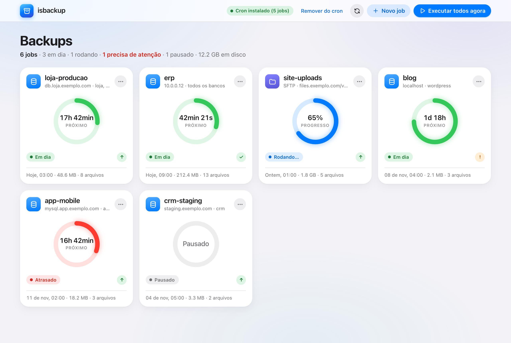
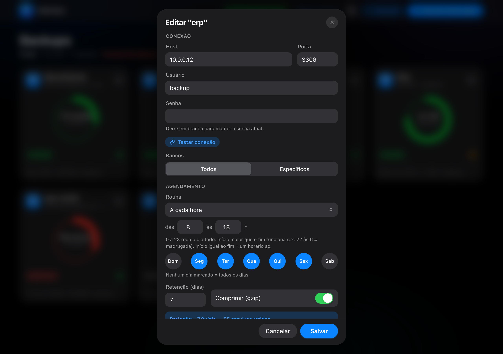
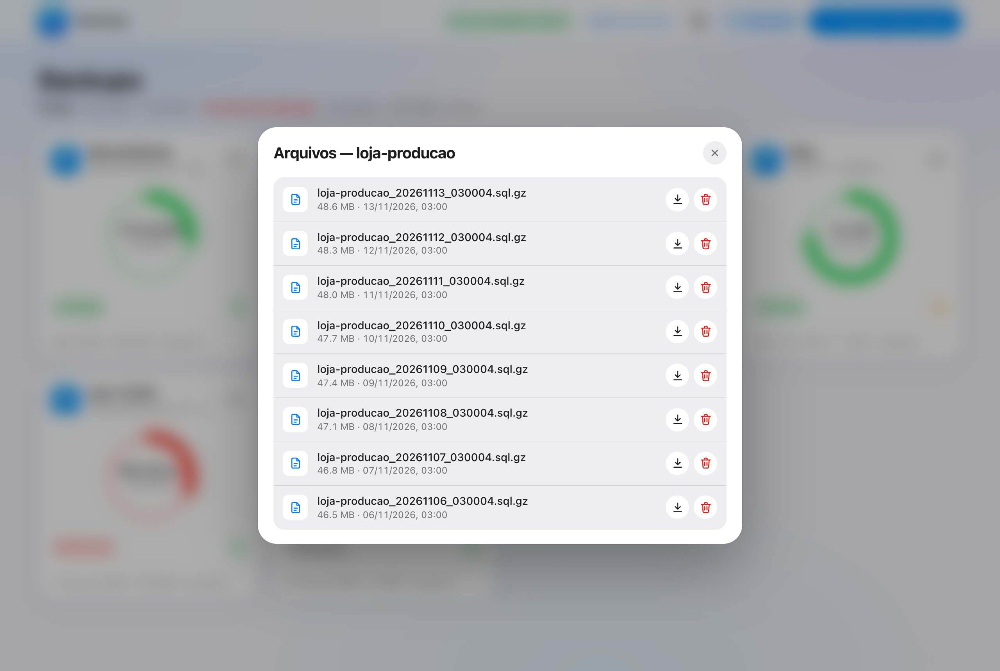
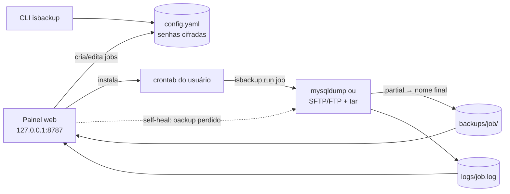

<div align="center">


# isbackup

**Backups de MySQL/MariaDB e de arquivos remotos (SFTP/FTP), com um painel bonito pra acompanhar tudo.**
<br />
Um arquivo YAML, o cron que já existe na sua máquina e nenhum servidor extra pra manter.

[](https://nodejs.org)
[](tsconfig.json)
[](test)
[](LICENSE)

[](#opção-2-docker-desktop)

<br />

<picture>
  <source media="(prefers-color-scheme: dark)" srcset="docs/dashboard-dark.png" />
  
</picture>

</div>

---

## Por que o isbackup?

Backup costuma cair num de dois extremos: um script `mysqldump` solto no crontab, que um dia para de
funcionar sem ninguém perceber, ou uma plataforma inteira (agente, banco próprio, Docker) que dá mais
trabalho que o problema. O isbackup fica no meio: **simples como o script, visível como a plataforma**.

| | |
|---|---|
| ⚡️ **Clona e roda** | `git clone` e depois `./run.sh` ou `./docker.sh`, você escolhe. O painel abre sozinho no navegador e os jobs você cria por ele, sem escrever YAML nem cron. |
| 🪶 **Zero infraestrutura** | Sem banco de dados, sem Docker, sem daemon próprio. O estado é o `config.yaml`, a pasta `backups/` e o crontab do usuário. |
| 👀 **Você vê quando algo dá errado** | Cada job tem um anel com a contagem até o próximo backup e um status de saúde (*em dia*, *atrasado*, *falhou*). Um backup que encolheu demais em relação ao anterior ganha um alerta. |
| 🔐 **Senhas cifradas** | AES-256-GCM, com a chave guardada só no `.env` (permissão `600`). O `config.yaml` nunca tem senha em texto puro, e a senha nunca aparece em `ps` nem em log. |
| 🛟 **Backups íntegros** | O arquivo é gravado como `.partial` e só ganha o nome final depois de completo e sincronizado com o disco. Um dump interrompido nunca se passa por backup válido. |
| 😴 **Sobrevive ao Mac dormindo** | O cron do macOS pula horários com a máquina dormindo. Com o painel aberto, o *self-heal* detecta o backup perdido e roda na hora. |
| 🧪 **Testar antes de salvar** | O botão "Salvar" só libera depois de um "Testar conexão" que autentica de verdade (`SELECT 1` no banco, listagem no SFTP/FTP). |
| 🧰 **CLI e painel, juntos** | Tudo que o painel faz também existe na linha de comando. Os dois leem e escrevem os mesmos arquivos e podem ser usados ao mesmo tempo. |

## Comece em 1 minuto

Escolha como rodar. As duas formas abrem o mesmo painel, com os mesmos recursos.

| | 🖥️ **Direto na máquina** (`./run.sh`) | 🐳 **Docker Desktop** (`./docker.sh`) |
|---|---|---|
| **Precisa de** | Node.js 22.12+ e o cliente do MySQL | Só o [Docker Desktop](https://www.docker.com/products/docker-desktop/) |
| **Instala algo no sistema?** | Node e `mysql-client` | Nada: tudo fica dentro do container |
| **Onde ficam os backups** | Na pasta que você escolher no painel (padrão: `./backups`) | Na pasta que você escolher na primeira vez (padrão: `./docker-data`) |
| **Quem agenda os backups** | O `cron` do seu usuário | Um `cron` dentro do container |
| **Bom para** | Quem já tem Node, ou servidores Linux | Quem quer começar sem instalar nada |

### Opção 1: direto na máquina

```bash
git clone https://github.com/rsportella/isbackup.git
cd isbackup
./run.sh
```

O `./run.sh` instala as dependências, compila, sobe o painel em **http://127.0.0.1:8787** e já o
abre no navegador. Se houver uma versão anterior rodando na mesma porta, ele a substitui. Para
outra porta: `./run.sh --port 9000`. Para não abrir o navegador: `./run.sh --no-open`.

<details>
<summary><strong>Requisitos</strong></summary>

- **Node.js 22.12 ou mais novo**
- **macOS ou Linux**, com `crontab` (já vem nos dois)
- Para jobs de banco, o cliente do MySQL (`mysqldump` e `mysql`):
  - macOS: `brew install mysql-client`. O isbackup acha o binário mesmo fora do `PATH`, inclusive quando roda pelo cron.
  - Debian/Ubuntu: `sudo apt install default-mysql-client`
- Para jobs de arquivos: nada além do `tar`, que já vem no sistema.

</details>

### Opção 2: Docker Desktop

Com o [Docker Desktop](https://www.docker.com/products/docker-desktop/) aberto (não precisa de
Colima nem de mais nada):

```bash
git clone https://github.com/rsportella/isbackup.git
cd isbackup
./docker.sh
```

Na primeira vez, o `./docker.sh` **pergunta onde guardar os dados** (configuração, chave das senhas e
backups) e constrói a imagem, o que leva menos de um minuto. Depois sobe o container, espera o
painel responder e o **abre no navegador** em **http://localhost:8787**. O container aparece na aba
**Containers** do Docker Desktop, onde dá para parar, iniciar e ver os logs com um clique.

> **Já usava o modo direto (`./run.sh`) nesta pasta?** O `./docker.sh` encontra os seus jobs e
> backups e oferece usar os mesmos. Se as rotinas ainda estiverem no crontab do computador, ele
> oferece passá-las para o container (remove só as linhas do isbackup do seu crontab, guarda uma
> cópia do crontab anterior e instala as rotinas no Docker), para nenhum backup rodar em dobro.

Prefere o Compose puro? `docker compose up -d` também funciona. Nesse caso os dados ficam em
`./docker-data` e você abre o navegador por conta própria.

A imagem já traz tudo: Node, `mysqldump` e `mysql`, `tar` e o `cron`. Testado de ponta a ponta
(conexão, cron e dump) com **MariaDB 11** e **MySQL 8.4**.

<details>
<summary><strong>Detalhes do modo Docker</strong></summary>

- **Seus dados** ficam na pasta escolhida (anotada em `docker.local.env`, fora do git):
  `config.yaml`, `.env` (a chave das senhas), `backups/` e `logs/`. O painel mostra o caminho no seu
  computador. Para trocar de pasta: `./docker.sh setup`. Recriar ou atualizar o container não apaga
  nada, e o crontab instalado pelo painel fica num volume próprio (`isbackup-cron`).
- **Banco na sua própria máquina:** dentro do container, `localhost` é o próprio container. Use
  `host.docker.internal` como host do job.
- **Banco em outro container:** coloque os dois na mesma rede do Docker e use o nome do container
  como host.
- **Fuso horário:** as rotinas seguem a variável `TZ` (padrão `America/Sao_Paulo`).
- **Outra porta:** `ISBACKUP_PORT=9000 ./docker.sh`. Dá para definir `TZ` do mesmo jeito.
- **Linha de comando:** `docker compose exec isbackup isbackup list` (ou `run <job>`, `cron status`…).
- **Atualizar:** `git pull && ./docker.sh` (ele sempre reconstrói com o código atual).
- **Parar e ver logs:** `./docker.sh down` e `./docker.sh logs`.
- **Mais de um Docker instalado?** O `./docker.sh` prefere o Docker Desktop quando ele está aberto.
  Para usar outro de propósito: `DOCKER_CONTEXT=colima ./docker.sh`.
- **Backups sempre ativos:** os backups rodam enquanto o Docker Desktop estiver aberto. Ative
  *Settings → General → Start Docker Desktop when you sign in*. O container sobe sozinho
  (`restart: unless-stopped`).
- **Segurança:** a porta é publicada só em `127.0.0.1` do seu computador. Não troque para `8787:8787`
  no `compose.yaml`: o painel não tem login.
- Usa outro Docker (Colima, OrbStack, Docker Engine no Linux)? Os mesmos comandos funcionam.

</details>

### Depois de abrir o painel

1. Clique em **Novo job** e escolha **Banco de dados** ou **Arquivos (SFTP/FTP)**.
2. Preencha a conexão e clique em **Testar conexão**.
3. Escolha a rotina (diária, a cada N horas, dias úteis…) e clique em **Salvar**.
4. Clique em **Instalar rotina no cron**. Pronto: os backups passam a rodar sozinhos.

> No primeiro uso é criado um `config.yaml` vazio. A chave que cifra as senhas é gerada no `.env`
> quando você salva o primeiro job. Nenhum dos dois vai para o git.

## Recursos

**Dois tipos de job**
- **Banco de dados**: `mysqldump` de MySQL ou MariaDB, de todos os bancos ou de uma lista, com
  `--single-transaction` (não trava as tabelas) e compressão gzip.
- **Arquivos**: busca arquivos de um servidor **SFTP ou FTP/FTPS**, desce pelas subpastas, filtra por
  padrão de nome (`*.zip`), trecho do nome e data de modificação, e compacta tudo num `.tar.gz`.

**Agendamento sem escrever cron**
- Diária, semanal, mensal, a cada hora ou a cada N horas, com janela de horário ("das 8 às 18h") e
  escolha dos dias da semana. Para quem prefere, também aceita uma expressão cron.
- Prévia ao vivo de quantos backups por dia a rotina gera e quantos arquivos a retenção vai manter.

**Painel**
- Visual no estilo dos apps da Apple, que também funciona no celular.
- Aparência **Automática** (segue o sistema e troca sozinha quando ele muda), **Clara** ou **Escura**,
  escolhida no botão ◐ da barra superior. A escolha fica salva no navegador.
- Progresso em tempo real (porcentagem, arquivos e tempo restante) e botão para parar um backup em andamento.
- **Onde guardar os backups:** o painel mostra a pasta em uso e o espaço livre, e deixa escolher
  outra (um HD externo, por exemplo; os discos conectados aparecem como sugestão), com a opção
  de mover os backups que já existem.
- Lista de backups com download e exclusão, e o histórico (log) de cada job.
- Aviso quando o crontab instalado está diferente da configuração atual.

**Confiabilidade**
- Retenção por dias, aplicada depois de cada backup bem-sucedido.
- Lock por job entre processos: o cron e o painel nunca rodam o mesmo backup em paralelo.
- `config.yaml` gravado de forma atômica: uma queda no meio da gravação não corrompe o arquivo.
- Logs por job em `logs/<job>.log`, com rotação automática ao passar de 1 MB.

<table>
  <tr>
    <td width="50%"></td>
    <td width="50%"></td>
  </tr>
  <tr>
    <td align="center"><sub>Rotinas sem escrever cron</sub></td>
    <td align="center"><sub>Arquivos de cada job, com download</sub></td>
  </tr>
</table>

## Como funciona



Cada job vira uma linha no crontab, marcada para o isbackup poder atualizar ou remover só as dele sem
mexer no resto. Na hora agendada, o cron chama `isbackup run <job>`, que grava o backup em
`backups/<job>/<job>_AAAAMMDD_HHMMSS.sql.gz` (ou `.tar.gz`), aplica a retenção e registra tudo no log
do job. O painel só lê esses mesmos arquivos. Não há nenhum estado escondido.

## Configuração

O jeito mais fácil é criar os jobs pelo painel. Se preferir editar à mão (ou versionar), o formato do
`config.yaml` é este (veja também o [`config.example.yaml`](config.example.yaml)):

```yaml
defaults:
  outputDir: ./backups # uma subpasta por job
  retentionDays: 7

jobs:
  - name: loja-producao
    host: db.exemplo.com
    user: backup
    password: enc:v1:Q2hh... # gere com: isbackup encrypt "sua-senha"
    databases: [loja, pagamentos] # ou: all
    schedule: daily # hourly | daily | weekly | monthly | "0 3 * * *"
    retentionDays: 14

  - name: site-uploads
    type: files
    schedule: "0 1 * * *"
    fileSource:
      protocol: sftp # ou ftp
      host: files.exemplo.com
      user: deploy
      password: enc:v1:Zm9v...
      remoteDir: /var/www/uploads
      pattern: "*.jpg" # opcional; só "*" é curinga
      modifiedWithinDays: 7 # opcional
```

<details>
<summary><strong>Todos os campos</strong></summary>

**Comuns aos dois tipos**

| Campo | Padrão | Descrição |
|---|---|---|
| `name` | obrigatório | Identificador único. Só letras, números, `-` e `_`. |
| `type` | `database` | `database` ou `files`. |
| `schedule` | obrigatório | Preset (`hourly`, `daily`, `weekly`, `monthly`) ou cron de 5 campos. |
| `outputDir` | `./backups` | Pasta de destino, relativa ao `config.yaml`. Cada job usa uma subpasta. |
| `retentionDays` | `7` | Backups mais antigos que isso são apagados (`0` = guardar todos). |
| `paused` | `false` | Tira o job da rotina do cron. `isbackup run` continua funcionando. |

**`type: database`**

| Campo | Padrão | Descrição |
|---|---|---|
| `host` / `port` | `localhost` / `3306` | Servidor MySQL/MariaDB. |
| `user` | obrigatório | Usuário. Aceita `${VARIAVEL}` do `.env`. |
| `password` | obrigatório | `enc:v1:...` (cifrada, recomendado) ou `${VARIAVEL}` do `.env`. |
| `databases` | `all` | `all`, um nome ou uma lista. |
| `gzip` | `true` | Comprime o dump. |

**`type: files`** (dentro de `fileSource`)

| Campo | Padrão | Descrição |
|---|---|---|
| `protocol` | obrigatório | `sftp` ou `ftp`. |
| `host` / `port` | obrigatório / `22` ou `21` | Servidor remoto. |
| `user` / `password` | obrigatórios | Credenciais; a senha segue o mesmo formato da senha do banco. |
| `remoteDir` | `/` | Pasta de origem. Subpastas são incluídas (até 10 níveis). |
| `pattern` | `*` | Padrão do nome do arquivo. Só `*` é curinga. |
| `nameContains` | — | Trecho do nome, sem diferenciar maiúsculas. |
| `modifiedWithinDays` | — | Só arquivos modificados nos últimos N dias. |
| `secure` | `false` | FTPS. Só vale para `ftp` (o SFTP já é cifrado). |

</details>

## Linha de comando

`./run.sh` sobe o painel. Para usar o comando `isbackup` direto no terminal, rode `npm link` uma vez
(ou use `node dist/cli.js` no lugar).

```bash
isbackup ui [--port 9000] [--open] # painel web (só em 127.0.0.1); --open abre o navegador
isbackup list                      # lista os jobs
isbackup run <job>                 # roda um job agora
isbackup run --all                 # roda todos
isbackup run <job> --dry-run       # mostra o que faria, sem executar
isbackup cron install [--dry-run]  # instala/atualiza as rotinas no crontab
isbackup cron status               # mostra o que está instalado
isbackup cron uninstall            # remove só as linhas do isbackup
isbackup encrypt "senha"           # cifra uma senha para o config.yaml
isbackup init                      # cria config.yaml e .env a partir dos exemplos
```

## Segurança

- **Senhas** são cifradas com AES-256-GCM (`node:crypto`, sem dependência externa). A chave
  (`ISBACKUP_ENCRYPTION_KEY`) fica só no `.env`, com permissão `600`. Sem o `.env`, o `config.yaml`
  não revela nenhuma senha. Guarde uma cópia da chave: sem ela, as senhas cifradas não podem ser lidas.
- **Credenciais do MySQL** vão num arquivo temporário `600`, apagado logo depois, e nunca em `-p`
  na linha de comando, onde apareceriam no `ps aux`.
- **Backups** são gravados com permissão `600`. Eles **não são cifrados**: se o conteúdo for
  sensível, use um disco ou volume cifrado no destino.
- **O painel não tem login, mas só atende a própria máquina.** Ele escuta só em `127.0.0.1` (no
  Docker, a porta é publicada só em `127.0.0.1` do seu computador) e, além disso, recusa:
  - pedidos endereçados a qualquer nome que não seja `127.0.0.1`, `localhost` ou `[::1]` —
    bloqueia o *DNS rebinding*, em que um site malicioso aponta o próprio domínio para a sua
    máquina para ler a API e baixar backups;
  - pedidos que o navegador marca como vindos de outro site, e ações (POST/PUT/DELETE) com origem
    diferente da do painel — um site aberto em outra aba não consegue rodar, pausar ou remover rotinas.

  Mesmo assim, **não exponha a porta na rede** (proxy reverso, túnel) sem colocar autenticação na
  frente. Se precisar acessar por outro nome (ex: `backup.lan` atrás de um proxy com login), libere-o em
  `ISBACKUP_ALLOWED_HOSTS=backup.lan`.

## Boas práticas

- **Deixe o painel aberto** (no Docker ele já fica sempre de pé; no modo direto, configure para
  subir com o login: LaunchAgent, `pm2`) para o
  *self-heal* cobrir horários perdidos com a máquina dormindo.
- **Copie os backups para fora da máquina** (outro disco, nuvem). Um backup que mora no mesmo
  disco do sistema não protege contra a perda desse disco.
- **Teste uma restauração de vez em quando.** Backup que nunca foi restaurado é só uma esperança.
- Depois de mudar rotinas ou atualizar o Node, clique em **Atualizar cron** quando o painel avisar.

## Limitações

- Bancos suportados: MySQL e MariaDB (via `mysqldump`).
- O agendamento depende do `cron`. No Windows, o caminho seria o modo Docker, mas isso ainda não
  foi testado.
- Editar pelo painel regrava o `config.yaml` e descarta comentários escritos à mão.

## Desenvolvimento

```bash
npm install
npm run dev -- list   # roda a CLI direto do TypeScript (tsx)
npm run typecheck     # checa os tipos de src/ e test/
npm test              # suíte de testes (node:test)
npm run build         # compila para dist/
```

```
src/
  cli.ts              comandos da CLI
  config.ts           leitura/validação/gravação atômica do config.yaml
  dump.ts             backup de banco (mysqldump)
  file-backup.ts      backup de arquivos (SFTP/FTP + tar)
  backups.ts          listagem, retenção e gravação via .partial
  cron.ts             geração e instalação das linhas do crontab
  run-lock.ts         lock entre processos e cancelamento
  crypto.ts           cifra das senhas (AES-256-GCM)
  web/                API do painel, self-heal e validação dos formulários
public/               painel (HTML, CSS e JS puros, sem build)
Dockerfile            imagem: Node + cliente MySQL + cron; dados em /data (ISBACKUP_HOME)
compose.yaml          sobe o container no Docker Desktop
docker.sh             sobe pelo Docker: pergunta onde guardar os dados e abre o navegador
run.sh                sobe direto na máquina e abre o navegador
docker/               entrypoint do container e atalho da CLI
test/                 testes; usam diretórios temporários e nunca tocam nos seus arquivos reais
```

Os testes sobem a API de verdade contra um projeto temporário e simulam o `mysqldump`, então rodam
sem banco nem servidor remoto.

## Licença

[ISC](LICENSE) © Rodolfo Portella

---

<div align="center">
  <sub>Criado e mantido por <strong>RSPortella</strong>. Se o isbackup te ajudou, deixe uma ⭐ no repositório.</sub>
  <br /><br />
  <a href="https://github.com/rsportella" title="GitHub"></a>
  &nbsp;
  <a href="https://www.linkedin.com/in/rsportella/" title="LinkedIn"></a>
  &nbsp;
  <a href="https://www.instagram.com/rsportella/" title="Instagram"></a>
  &nbsp;
  <a href="mailto:rodolfosportella@gmail.com" title="rodolfosportella@gmail.com"></a>
  <br />
  <sub><a href="mailto:rodolfosportella@gmail.com">rodolfosportella@gmail.com</a></sub>
</div>
